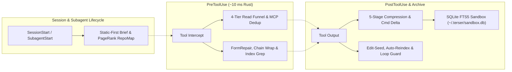

<div align="center">

<picture>
  
</picture>

<br />

[](plugin.json)
[](#measured-benchmarks)
[-F97316?style=flat-square)](#native-rust-hot-path-terser-fast)
[](#quick-start)
[](#quick-start)
[](LICENSE)

<h3>Lossless context compression, AST code indexing, and ~10 ms Rust hooks<br />for Antigravity 2.0, Claude Code, Codex, opencode, and Cursor.</h3>

[Quick Start](#quick-start) · [Benchmarks](#measured-benchmarks) · [Architecture](#architecture) · [Capabilities](#capabilities--extensions) · [CLI & Autopilot](#cli-slash-commands--autopilot) · [Configuration](#configuration)

</div>

---

## Why Terser?

AI coding agents burn most of their context window on noise: bloated MCP tool schemas, repeated full-file reads, verbose build and test logs, repetitive JSON/NDJSON payloads, lockfile diffs, and retry loops.

**Terser** intercepts that waste across the entire tool and subagent lifecycle—cutting token usage by **94.5%** while preserving **100% of errors, tracebacks, diffs, and exit codes** and keeping KV prompt-cache prefixes warm.

### Before vs. After

| Everyday Agent Action | Without Terser | With Terser |
| :--- | :--- | :--- |
| **MCP AST server schemas** | Loads 90+ tool schemas (~25,800 tok) | 6-tool Counter front door (**~1,050 tok**, **−95.9%**) |
| **Re-reading an unchanged 300L file** | Full file re-sent (~3,603 tok) | T0 hash dedup / edit-seeded hit (**~38 tok**, **−98.9%**) |
| **Re-reading after a 2-line edit** | Full file re-sent (~3,603 tok) | T1 exact unified delta diff (**~93 tok**, **−97.4%**) |
| **Opening a large code / doc file** | Entire 300L+ file (~3.6k–5.7k tok) | T2/T2b/T2c outline-first + range trim (**~333–692 tok**) |
| **Running `cargo build` / `pytest`** | Full verbose log (~447–505 tok) | Stream filter + delta-diff (**~34–122 tok**, errors 100%) |
| **Oversized 50 KB tool output** | Dumped raw into context | Redacted & archived to SQLite FTS5 → `terse query --last` |

### Core Guarantees

- **Zero Quality Compromise:** Errors, stack traces, diffs, and exit codes pass through verbatim. Oversized outputs are secret-redacted and archived locally in SQLite FTS5 for instant drill-down.
- **KV Prompt-Cache Safe:** Static-first, byte-stable session briefs and deterministic PageRank repo maps never bust prompt prefix caches.
- **~10 ms Native Hot-Path:** Default-on Rust accelerator (`terser-fast`) runs `PreToolUse` / `PostToolUse` hooks **14.1× faster** (`~147 ms` → `~10 ms`), with lazy pure-Python stdlib fallback.
- **Subagent-Native:** Full `SubagentStart` / `SubagentStop` hooks, compact economy briefs, and opt-in low-cost subagent routing with zero-token citation verification.
- **100% Local & Fail-Open:** Zero runtime dependencies, zero telemetry. Every hook exits `0` on error so your workflow is never blocked.

---

## Quick Start

> **Requirements:** **Python 3.10+** (pure stdlib — zero `pip install` or external MCP packages required; Python 3.11+ for the Codex marketplace builder). **Rust (`cargo`)** is optional — prebuilt `terser-fast` binaries are fetched automatically from [GitHub Releases](https://github.com/HyperExtendedReality/terser/releases) or compiled locally if `cargo` is present.

### 1. Clone the repository

```bash
git clone https://github.com/HyperExtendedReality/terser.git
cd terser
```

### 2. Install for your host

| Host | Install Command | What Gets Installed |
| :--- | :--- | :--- |
| **Antigravity 2.0 / IDE / `agy`** | `python scripts/install.py --antigravity` | Plugin in `~/.gemini/config/plugins/terser/`, OS-native zero-flash hooks, 6-tool Counter MCP + HUD app |
| **Claude Code** | `claude plugin marketplace add "/path/to/terser"`<br />`claude plugin install terser@terser` | Marketplace plugin, hooks, 6 slash commands, 4 skills, optional `--statusline` & `mods/terser-hud` |
| **Codex** | `python scripts/install.py --codex`<br />`codex plugin marketplace add "/path/to/terser/dist/codex"`<br />`codex plugin add terser@terser` | Local marketplace bundle (MCP server, skills, hooks); migrates legacy entries |
| **opencode** | `python scripts/install.py --opencode` | Plugin in `~/.config/opencode/plugins/terser.js` + prints `terser-index` entry for `opencode.json` |
| **Cursor** | `python scripts/install.py --cursor` | Merges hooks into `~/.cursor/hooks.json` and `terser-index` into `~/.cursor/mcp.json` |

Or configure multiple hosts at once:

```bash
python scripts/install.py --all            # Configure Antigravity, Codex & print Claude commands
python scripts/install.py --all --dry-run  # Preview changes without modifying files
python scripts/install.py --all --uninstall
```

### 3. Verify your installation

```bash
python runtime/cli.py doctor   # Checks Python, Rust hot-path, manifests, MCP, and SQLite sandbox health
```

> [!TIP]
> If you previously installed standalone token-optimization or code-indexing plugins, disable them in your host's plugin manager to avoid duplicate hooks and tool schemas.

<details>
<summary><strong>Host-specific setup notes (Antigravity, Claude Code, Codex, opencode &amp; Cursor)</strong></summary>

#### Antigravity 2.0 / IDE / `agy`
Safe to re-run in place on Windows even while Antigravity is running. Installs OS-native launchers with no console window flash.

#### Claude Code
- **Update after pulling:** `claude plugin update terser@terser`
- **Single-session test (no install):** `claude --plugin-dir "/path/to/terser"`
- **Optional status line:** `python scripts/install.py --statusline` (never overwrites an existing status line; `--statusline --uninstall` removes only Terser's).

#### Codex
- Review registered hooks via `/hooks` in the CLI or **Settings → Hooks** in the desktop app.
- Verify health with `python runtime/cli.py --host codex doctor`.
- **Tool output & `terse exec`:** Codex receives original shell/MCP results via `PostToolUse`. Enable `codex_form_repair=true` for verified executable spelling fixes and `codex_mcp_refetch_guard=true` for same-turn reuse of `menu`/`route` results.
  - Inside `terser-index`, batch `get_symbol_source` calls share overlapping lines from the same file revision; pass inclusive `start_line`/`end_line` for exact ranges, or `args.reuse_visible_result=true` (with explicit `repo` and `symbol_id`) to skip one same-turn refetch.
  - For bounded non-interactive commands with cross-run deltas, run `terse exec --sid <session-id> -- git status --short` (preserves exit status & stderr; recover raw stdout with `terse expand <id> --raw`; also reads `TERSER_SESSION_ID` or `CODEX_THREAD_ID`).

#### opencode & Cursor
Verify either install end-to-end with `python scripts/install.py --opencode --doctor` or `--cursor --doctor`. Because opencode and Cursor leave some hook details undocumented, Terser assumes the following and fails open if an assumption changes:

- **opencode:** Uses the V1 plugin API (`tool.execute.before`/`after`, `experimental.chat.system.transform` for the session brief). Accepts `filePath` or `path`; skips read dedup on ranged reads (unconfirmed offset base); passes MCP tools through unchanged. Respects `$OPENCODE_CONFIG_DIR`.
- **Cursor:** `preToolUse` and `subagentStart` always return `{"permission": "allow"}` unless denying (empty output blocks). Shell output cannot be rewritten in Cursor, so it gets read outlines, shell form repair, loop nudges, and edit hints without output compression. MCP output rewriting stays off until `cursor_mcp_output_rewrite` is enabled. Respects `CURSOR_HOME`. On Windows, hook commands start with PowerShell's `&` call operator.

</details>

---

## Measured Benchmarks

Reproduce these numbers offline anytime with `scripts/terse benchmark` (or `python scripts/benchmark.py`):

| Optimization Layer | Before | After | Saved | Reduction |
| :--- | ---: | ---: | ---: | :--- |
| **MCP Schema** (6-tool Counter vs Full) | 25,800 tok | 1,050 tok | **95.9%** | `██████████` |
| **Read Funnel T0** (Unchanged Re-read Dedup) | 3,603 tok | 38 tok | **98.9%** | `██████████` |
| **Read Funnel T1** (Small-Edit Unified Delta) | 3,603 tok | 93 tok | **97.4%** | `██████████` |
| **Read Funnel T2** (Outline-First Code) | 3,603 tok | 692 tok | **80.8%** | `████████░░` |
| **Read Funnel T2b** (Outline-First Docs) | 5,753 tok | 333 tok | **94.2%** | `█████████░` |
| **Stream Output Filter** (Cargo Build) | 447 tok | 34 tok | **92.4%** | `█████████░` |
| **Lossless Columnar JSON Folding** | 1,751 tok | 205 tok | **88.3%** | `█████████░` |
| **Command Delta-Diff** (Repeat `pytest`) | 505 tok | 122 tok | **75.8%** | `████████░░` |
| **SQLite FTS5 Sandbox Query** | 5,678 tok | 462 tok | **91.9%** | `█████████░` |
| **SmartCrusher JSON** (120 API items) | 4,342 tok | 115 tok | **97.4%** | `██████████` |
| **Git Lockfile Diff Elision** | 3,855 tok | 72 tok | **98.1%** | `██████████` |
| **TOTAL (pooled across 8 layers)** | **58,940 tok** | **3,216 tok** | **94.5%** | `█████████▌` |

> [!NOTE]
> For Codex parity, hook latency, and rollout comparisons, run `terse --host codex benchmark` — add `--codex-rollouts baseline.jsonl candidate.jsonl` to compare uncached input, cached input, and output tokens across two rollouts.

---

## Architecture



### The 8-Layer Optimization Stack

| # | Layer | Mechanism | Key Result |
| :---: | :--- | :--- | :--- |
| **1** | **6-Tool AST Front Door (`terser-index`)** | Replaces 90+ verbose MCP schemas with 6 Counter tools backed by an incremental SQLite + FTS5 trigram index (`.gitignore`-aware, optional `tree-sitter-language-pack`, `TERSER_INDEX_WORKERS=N`). | **95.9%** schema cut (~0.6s warm re-index on 1.5k files) |
| **2** | **4-Tier Read Funnel** | **T0** hash dedup · **T1** unified delta · **T1b** whole-symbol delta · **T2/T2b/T2c** outline-first (`>=10 KB`, `>=250L`) · **T3** ranged overlap trim, plus edit-miss recovery and 7-day retry backoff. | **80–99%** cut on file reads |
| **3** | **FormRepair & 5-Stage Compression** | Repairs shell/PowerShell commands & wraps `&&` chains; strips ANSI, runs native tool handlers (`git`, `cargo`, `pytest`, `go`, `jest`/`vitest`, `dotnet`, `npm`/`pnpm`/`uv`, `gradle`/`maven`, `docker`, `terraform`, `tsc`/`eslint`/`ruff`/`mypy`/`pyright`/`biome`/`oxlint`), compacts diffs/tables/tracebacks, and diffs repeated commands. | **75–98%** cut; errors & exit codes 100% verbatim |
| **4** | **SmartCrusher JSON & NDJSON** | Losslessly flattens uniform nested objects and factors `_const`, `_seq`, `_prefix`, `_dict`, and `_default`/`_sparse` columns across JSON arrays, GraphQL payloads, and mixed NDJSON streams while keeping headers and error/outlier items. | **88–97%** cut; raw payload archived |
| **5** | **SQLite FTS5 Context Sandbox** | Secret-redacts, content-addresses, and chunk-indexes oversized shell, MCP, `Glob`, `Grep`, and web outputs with Porter stemming + BM25 (`~/.terser/sandbox.db`, auto-pruned at 7d / 50 MB). Lazy-ingests Rust raw sidecars. | **91.9%** cut with instant full-text drill-down |
| **6** | **Static-First Brief & PageRank RepoMap** | Emits a byte-stable `SessionStart` brief (`<=1600` chars) plus a `<150 ms` AST import-graph PageRank map (~300 tok) only when unindexed. | Keeps KV prompt prefix caches 100% warm |
| **7** | **Subagent Lifecycle & Verified Routing** | `<220`-token `rules/AGENTS.md` policy, 4 skills, `SubagentStart`/`SubagentStop` hooks, and opt-in cheap-tier routing (`terse routing on`) with `[Terser Verify]` zero-token citation checks (auto-pauses 7d if >35% fail). | Lower subagent cost with verified accuracy |
| **8** | **Unified Loop Guard & Auto-Reindex** | Per-session 45s cooldown, content-hashed edit signatures (no false positives on multi-region edits), and index-gated incremental AST re-indexing on file edits. | Stops thrash loops & keeps AST index fresh |

<details>
<summary><strong>Deep dive: Read Funnel safety, verified seeding &amp; Edit-Miss Recovery</strong></summary>

- **Verified edit/write seeding:** The read cache only advances after `Edit`, `MultiEdit`, or `Write` when the file on disk matches the cached text with edits applied (CRLF-aware). If a formatter or external writer modified the file, the next read returns an exact diff instead of `"unchanged"`.
- **T1b symbol delta:** When changes exceed the 60-line unified diff cap but sit inside a few functions or classes, Terser returns only those whole symbols bounded by unchanged anchor lines (with old/new line ranges). Retrying loads the full file.
- **Edit-miss recovery:** Failed `Edit` / `MultiEdit` calls (`old_string` not found or ambiguous) receive the closest matching region with line numbers and the exact cause (e.g., tabs vs. spaces), or every ambiguous match's line number—avoiding a full re-read.
- **Self-tuning backoff:** Short answers and immediate retries are logged to `~/.terser/funnel.jsonl`. Any tier (`t0`, `t0b`, `t1`, `t1sym`, `t2`) with ≥12 short answers and >50% retry rate over the last 7 days automatically switches off for that host until old events age out. Both Python and Rust honor `~/.terser/funnel-backoff.json`.
- **Shared snapshots:** Delta-diff snapshots are stored once per SHA-verified hash in `~/.terser/read-cache/blobs/` and shared across sessions and subagents.

</details>

---

## Capabilities & Extensions

### Code Mode (Local Script & Batch Actions)

Run targeted local operations through `terser-index`'s `order` tool and return only the printed result—never pulling large files into context:

| Action | What It Does |
| :--- | :--- |
| `run_script` | Execute local Python, Node, Bash, or PowerShell. Python gets a built-in `t` helper (`t.files`, `t.grep`, `t.count`, `t.symbols`, `t.source`, `t.refs`, `t.read`, `t.json`/`toml`/`csv`/`ini`/`py_ast`, plus staged edits `t.replace`, `t.sub`, `t.write`, `t.edit_symbol`). |
| `code_search` | Find files matching ALL / ANY / NONE of multiple regexes (`"uses X but not Y"`), returned as files, counts, or hits. |
| `code_edit` | Batch exact, regex, or whole-symbol edits across files—validated together and written all-or-nothing. |
| `code_query` | Extract values from JSON, JSONL, TOML, CSV, or INI by dotted path (`dependencies.*`, `items[0].name`), or return a key outline. |
| `fetch_and_index` | Fetch a URL once, archive it to FTS5, and return its outline plus sections matching `query`. |

> Edits default to dry-run diffs unless `apply: true`. Failed scripts write nothing, writes stay confined to the repo root, and modified files are automatically re-indexed and evicted from the read cache. Disable anytime with `terse config set code_mode=false`.

### Compress Any MCP Server (`terse mcp-proxy`)

Wrap any stdio MCP server to shrink both tool definitions and responses without touching the server code:

```bash
terse mcp-proxy -- npx -y <server>
terse mcp-proxy --lazy-tools -- npx -y <server>   # 1-sentence descriptions + on-demand terser_tool_help
```

- Trims `tools/list` descriptions while preserving names, types, `required`, and enums (`--no-desc` leaves schemas untouched).
- Compresses `tools/call` text responses losslessly up to 8 KB and archives larger payloads with an FTS5 retrieval hint. Error responses are never altered.

### Live HUD, Status Line & Analytics

| Surface | How to Enable / Open | What It Shows |
| :--- | :--- | :--- |
| **Interactive HUD MCP App (`terser_hud`)** | Built-in (`assets/hud_app.html`) in MCP App-capable hosts | Live session savings, per-engine breakdown, context fill, quality grade, and live config controls |
| **Claude Code Desktop Status Band** | `claude --plugin-dir mods/terser-hud` *(or `CLAUDE_CODE_PLUGIN_DIRS`; set `TERSER_ROOT` if relocated)* | Live bar above the prompt: session savings & `$` value, est. API cost, context fill (`green` / `amber` 70% / `red` 85%), cache hit rate, grade, all-time savings, **Router** dropdown (Off / Haiku / Sonnet / Fable), and **Details** pane (`/terser-hud`) |
| **Claude Code Status Line** | `python scripts/install.py --statusline` | Wires `runtime/statusline.py` into Claude Code's `statusLine` setting |
| **Local HTML Dashboard** | `terse dashboard` | Generates and opens a standalone local analytics dashboard in your browser |

### Repository Intelligence & SCIP

Available via `terser-index` (`order`), all monorepo-scoped with `path_prefix`:

- **Code intelligence actions:** `get_hotspots`, `get_symbol_history`, `get_untested_symbols`, `get_class_hierarchy`, `find_implementations`, `find_similar_symbols`, `get_symbol_diff`, `get_pr_risk_profile`, `get_layer_violations`, `list_workspaces`, and `import_scip` (enables compiler-precise `find_references`).
- **60+ language extensions:** Structural indexing covers Elixir, Haskell, OCaml, F#, Clojure, R, Julia, Nim, Solidity, Protobuf, GraphQL, Terraform, Shell, PowerShell, Perl, Pascal, Fortran, Vue/Svelte, VB, CUDA/shaders, Verilog, VHDL, and more.
- **Per-repo config:** Customize indexing and architecture rules in `<repo>/.terser/config.toml` (`[index] skip` / `extensions`, `[analysis] test_globs`, `[[layers]]`).

### Custom Filters, `.contextignore`, Compaction & YouTube

- **`command-filters.toml`** (`~/.terser/` and `<repo>/.terser/`): Define `[[filter]]` rules (`match`, `drop`/`keep` regexes, optional built-in `handler`) and `[exclude] commands = [globs]`. Error/warning lines are never dropped. Test rules with `terse filters test "<cmd>"`.
- **`.contextignore`** (repo root and `~/.terser/`): Gitignore-style patterns (`!pattern` to re-include) excluding files from context reads and indexing.
- **Activity-aware compaction & lean resume:** `PreCompact` detects the active mode (`code`, `debug`, `review`, `infra`, `research`) and preserves up to 10 verbatim session decisions. `terse resume-lean` builds a token-free restart brief from the last checkpoint, events, and `git status`.
- **YouTube transcript compaction:** Fetching a YouTube URL (Claude `WebFetch` or `terse youtube`) uses local `yt-dlp` to extract and compact captions with every word preserved, caches by video ID, and indexes into FTS5.

### Native Rust Hot-Path (`terser-fast`)

`scripts/install.py` enables the ~390 KB native Rust binary (`native/terser-fast/` → `bin/terser-fast`) **by default**—reusing an existing build, compiling with `cargo` if present, or downloading the matching binary from [GitHub Releases](https://github.com/HyperExtendedReality/terser/releases). Pass `--no-native` for pure Python stdlib.

- **14.1× faster hooks (`opt-level = 3` + LTO):** Cuts `PreToolUse` latency from **~147 ms → ~10 ms** with direct native hook dispatch (Antigravity including `Stop`/`PreInvocation`, Claude Code, Codex, and Cursor) and lazy Python submodule loading.
- **Broad native parity:** Runs Read Funnel T0/T0b/T1/T3 (byte-exact port of CPython `difflib.unified_diff`), MCP refetch dedup, Loop Guard, `SubagentStart`/`SubagentStop`, complexity routing, native lossless JSON minification & columnar folding (`<= 64 KB`), `terser-fast compress` (zero-alloc ANSI fast path, expanded lockfile elision, diff header compaction, table-to-TSV, path elision, compiler-note dedup, stack-frame folding, stream filters, duplicate collapse), and `terser-fast exec`.
- **PowerShell parity:** Claude Code's `PowerShell` tool receives the same FormRepair (plain executable swaps only—no POSIX syntax) and stdout/stderr compression as `Bash`.
- **No-op gates & warm Python worker:** `Bash`/`PowerShell`/`Grep`/`grep_search` `PreToolUse`, `UserPromptSubmit`, and `Stop`/`SessionEnd` (with O(1) `savings.jsonl` mtime fast-path) skip Python when provably a no-op. Delegated events route to a single warm `unified_hook.py --serve-worker` per checkout (diff-updated env, throttled reload check, `PRAGMA schema_version`-cached SQLite, 15-min idle exit; disable via `TERSER_PYTHON_WORKER=0` or `"python_worker": false`).

---

## CLI, Slash Commands & Autopilot

### Zero-Touch Autopilot

Everyday workflows run automatically without memorizing slash commands (each toggleable via config or `TERSER_*` env vars):

- **Archived output pointers** reference the built-in MCP call (`order(action="search_sandbox"|"expand_sandbox", ...)`), never requiring `terse` on `PATH`.
- **Background first-time indexing** (`index_auto_init`, default up to 5,000 source files) indexes unindexed git repos at session start.
- **Stat-only health checks** (`health_check`) surface a user-only `Terser degraded: ...` notice with the exact `doctor` command only when something is broken.
- **Plain-language intent hints** (`intent_hints`) inject exact commands for prompts like *"how much has terser saved?"* or *"show me the full output"*.
- **Context-fill nudges & savings summary** (`context_fill_nudges`, `session_summary`) alert at 70% / 85% context fill (Claude Code & Codex) and show a concise end-of-turn savings line starting at 5k tokens (then each doubling).

### Slash Commands & Agent Skills

| Interface | Hosts | Available Entries |
| :--- | :--- | :--- |
| **Slash Commands** | Claude Code | `/terser:status`, `/terser:audit`, `/terser:dashboard`, `/terser:doctor`, `/terser:tune`, `/terser:routing` |
| **Agent Skills** | Antigravity, Claude Code, Codex | `terser` *(status/audit/dashboard)*, `terser-index` *(AST symbol-first navigation)*, `terser-tune` *(settings, micro-skills, tool pruning)*, `terser-routing` *(low-cost subagent routing & verification)* |

### `terse` CLI Quick Reference

Invoke via `scripts/terse` (macOS/Linux), `scripts/terse.cmd` (Windows), or `python runtime/cli.py`:

| Category | Command | Purpose |
| :--- | :--- | :--- |
| **Monitor & Audit** | `terse status` | Live status, per-layer % savings, funnel retry ratios & session regret signals |
| | `terse savings` | Cumulative tokens saved broken down by optimization layer |
| | `terse grade` | Session quality grade (`0–100`) with reasons & regret signals |
| | `terse hud --json` | Single JSON snapshot backing `mods/terser-hud` and `terser_hud` |
| | `terse benchmark` | Reproducible 8-layer local token-savings benchmark |
| | `terse audit [--days N]` | Full session token & cost waste audit with regret signals |
| | `terse discover --replay [--days N] [--json]` | Read-only counterfactual replay of Claude Code / Codex transcripts |
| | `terse audit-config` / `terse security-report` | Static context bloat & secret-leak workspace audit |
| | `terse dashboard` | Generate & open the local HTML analytics dashboard |
| | `terse doctor` | Verify Python, Rust hot-path, engines, manifests, MCP & SQLite sandbox |
| **Navigate & Route** | `terse query <id\|--last> "<terms>"` | SQLite FTS5 search over an archived output (incl. Rust raw sidecars) |
| | `terse expand <id\|--last> [start end]` | Expand a line range (or `--raw` full text) of an archive |
| | `terse repomap [--budget 400]` | Generate a byte-stable PageRank structural repo map |
| | `terse route "<task>"` | Zero-cost task complexity router (tier + score) |
| | `terse routing [status\|on\|off\|verify\|model\|check]` | Configure low-cost subagent routing + zero-token verification |
| **Run & Wrap** | `terse exec --sid <id> -- <cmd...>` | Bounded argv runner with cross-run command delta-diff & raw archive |
| | `terse mcp-proxy [--lazy-tools] -- <cmd...>` | Compress any stdio MCP server's schemas and tool responses |
| **Tune & Maintain** | `terse config show \| set <k>=<v> \| reset` | Inspect, modify, or reset persistent settings |
| | `terse microskills [forget\|unforget]` | Manage learned repo EnvFacts micro-skills |
| | `terse toolprune [status\|apply\|restore]` | Review, apply, or restore unused tool pruning |
| | `terse coach` | Project-level token-efficiency coaching |
| | `terse filters [test "<cmd>"]` | Inspect `command-filters.toml` / `.contextignore` and test matching rules |
| | `terse resume-lean` | Build a token-free restart context for the current workspace |

> [!TIP]
> Pass `--price-in <$/MTok> --reread-turns <N>` to `status`, `audit`, `discover`, or `dashboard` to customize the value model (a kept-out token is valued as 1 cache write + *N* cache reads; defaults: `$3`, `3`).

---

## Configuration

All local state and settings live in `~/.terser/` (override with `TERSER_HOME`). Persist changes with `terse config set <key>=<value>` or reset with `terse config reset`.

| Environment Variable | Effect |
| :--- | :--- |
| `TERSER_HOME` | Override state directory (default: `~/.terser`) |
| `TERSER_DISABLE=1` | Temporarily disable all hooks (instant passthrough) |
| `TERSER_SHADOW=1` | Shadow mode — log decisions without altering tool calls |
| `TERSER_PYTHON` | Explicit Python interpreter path for launchers & Rust delegation |
| `TERSER_PYTHON_WORKER=0` | Disable the warm Python hook worker |
| `TERSER_INDEX_WORKERS=N` | Parse files in `N` worker processes during `index_folder` (opt-in, 48+ changed files) |
| `TERSER_DISABLE_TREE_SITTER=1` | Force regex symbol extractor even if `tree-sitter-language-pack` is installed |

<details>
<summary><strong>All feature toggles &amp; environment overrides</strong></summary>

| Environment Variable | Config Key | Default | Effect |
| :--- | :--- | :---: | :--- |
| `TERSER_OUTLINE_FIRST=0` | `outline_first` | `true` | Outline-first reads for large files (`>=10 KB`, `>=250L`) |
| `TERSER_BASH_COMPRESS=0` | `bash_compress` | `true` | Shell / PowerShell output compression |
| `TERSER_LOOP_GUARD=0` | `loop_guard` | `true` | Loop / thrash intervention |
| `TERSER_SUBAGENT_ROUTING=0` | `subagent_routing` | `false` | Opt-in low-cost subagent model routing |
| `TERSER_AUTO_REINDEX=0` | `auto_reindex` | `true` | Incremental AST auto-reindexing on edits |
| `TERSER_GREP_ANSWER=0` | `grep_answer` | `true` | Index-backed answers for huge `Grep` calls |
| `TERSER_AUTO_INDEX=0` | `index_auto_init` | `true` | Background first-time indexing of unindexed git repos |
| `TERSER_HEALTH_CHECK=0` | `health_check` | `true` | `SessionStart` self-check & MCP failure hints |
| `TERSER_INTENT_HINTS=0` | `intent_hints` | `true` | Plain-language Terser request hints |
| `TERSER_SESSION_SUMMARY=0` | `session_summary` | `true` | End-of-turn session savings summary line |
| `TERSER_CONTEXTIGNORE=0` | `contextignore` | `true` | Respect `.contextignore` exclusions |
| `TERSER_CODE_MODE=0` | `code_mode` | `true` | Local Code Mode script/batch actions via `order` |
| `TERSER_WEB_ARCHIVE=0` | `web_archive` | `true` | Archive large `WebFetch` pages (`web_archive_threshold=12000`) |
| `TERSER_JSON_LOSSY=1` | `json_lossy` | `false` | Opt-in pruning of nulls, empties, trace/request IDs (500-char string cap; raw archived) |

Additional config keys (`terse config set <key>=false` to disable):
- `symbol_delta` — T1b whole-symbol delta reads
- `edit_miss_hints` — Closest-match region hints on failed `Edit` / `MultiEdit`
- `search_repeat_elision` — Once-per-session elision of identical `Glob` / `Grep` results
- `compact_recall` — Re-inject matching edits, errors, and commands on the 3 prompts after compaction
- `fanout_checkpoint` — Save continuity before `Agent` / `Task` fan-out (at most once per rollup window)
- `lean_replies` — One static brief line asking for answer-first replies *(not sent to Codex)*

</details>

---

## Safety, Privacy & Reliability

- **100% Local:** Zero telemetry and zero background network calls. Outbound requests happen only when explicitly invoking `fetch_and_index` with a URL or extracting a YouTube transcript via your local `yt-dlp`.
- **Fail-Open & Self-Healing:** Every lifecycle hook is wrapped in defensive error handling and exits `0` so an edge case never blocks your agent. Corrupted SQLite sandbox databases auto-heal on connect and via `terse doctor`.
- **Secret-Safe & Reversible:** Oversized outputs are redacted for secrets/PII before indexing and remain searchable in `~/.terser/sandbox.db` via `terse query --last` or `terse expand --last`. Shadow mode (`terse config set shadow=true`) lets you audit decisions with zero mutation.

---

<details>
<summary><strong>Development, Testing &amp; Releases</strong></summary>

```bash
# Run the full Python & native integration test suite
python -m unittest discover -s tests -v

# Run Rust unit tests
cargo test --manifest-path native/terser-fast/Cargo.toml

# Run the local token-savings benchmark
# (--check fails on regressions vs scripts/benchmark_baseline.json; --write-baseline updates it)
python scripts/benchmark.py

# Force-rebuild the Rust hot-path accelerator (~10ms hook latency)
python scripts/install.py --build-native --antigravity

# Bump semantic version across all manifests & rebuild standalone dist/ bundles
python scripts/install.py --bump patch --build-dist
```

</details>

---

## Third-Party Code & License

`vendor/tokeneconomizer/` is TokenEconomizer (MIT, © Microsoft), bundled with its `LICENSE`. All other code—including analytics, command handlers, code outlines, shell safety gates, and redaction—is Terser's own. See [THIRD_PARTY_NOTICES.md](THIRD_PARTY_NOTICES.md).

Licensed under the [GNU General Public License v3.0 (GPL-3.0)](LICENSE) © 2026 HyperExtendedReality.
