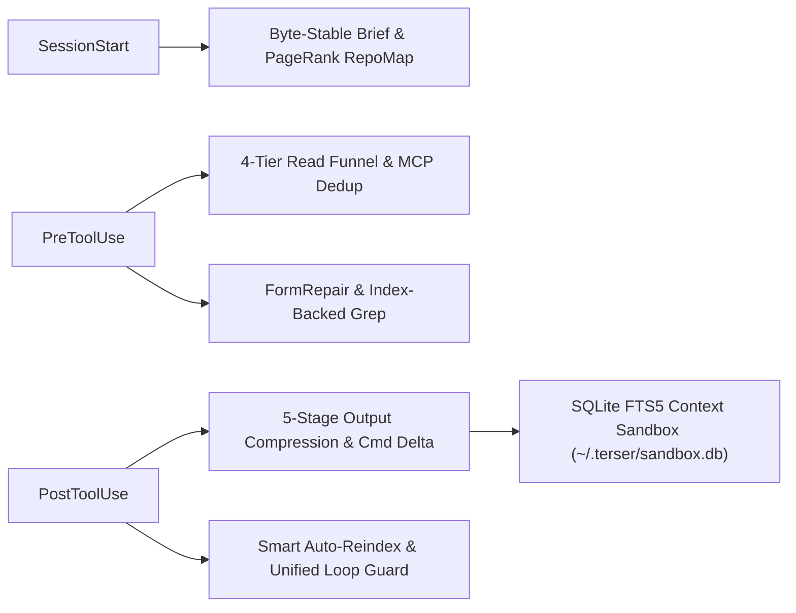

<div align="center">


# Terser

**Lossless context compression & token-efficiency engine for AI coding agents.**

*One fast, single-process, fail-open plugin for **Antigravity 2.0**, **Claude Code**, and **Codex**.*

[](plugin.json)
[](#requirements)
[](#safety--privacy)
[](#installation)
[](#license)

</div>

---

## Why Terser?

AI coding agents burn most of their context window on noise: bloated MCP tool schemas, repeated full-file reads, verbose build/test logs, redundant JSON payloads, and retry loops.

**Terser** intercepts that waste across the entire tool lifecycle—**without sacrificing code quality, error fidelity, or KV prompt-cache hits**:

- **94.4% measured token reduction** across 8 optimization layers on realistic developer workloads.
- **Zero quality compromise:** Errors, tracebacks, diffs, and exit codes are preserved 100% verbatim; full raw outputs are indexed locally in SQLite FTS5 for instant drill-down.
- **KV prompt-cache safe:** Byte-stable session briefs and deterministic PageRank repo maps keep prefix caches warm.
- **Single-process & fail-open:** Pure Python stdlib runtime, zero network calls, zero telemetry, and every hook exits `0` on error so your workflow is never blocked.

---

## Measured Benchmark

Run the reproducible, zero-network local benchmark anytime via `scripts/terse benchmark`:

| Optimization Layer | Before (tok) | After (tok) | Saved |
| :--- | ---: | ---: | ---: |
| **MCP Schema** (6-tool Counter vs Full) | 25,800 | 1,050 | **95.9%** |
| **Read Funnel T0** (Unchanged Re-read Dedup) | 3,603 | 38 | **98.9%** |
| **Read Funnel T1** (Small-Edit Unified Delta) | 3,603 | 93 | **97.4%** |
| **Read Funnel T2** (Outline-First Code) | 3,603 | 689 | **80.9%** |
| **Read Funnel T2b** (Outline-First Markdown) | 5,753 | 329 | **94.3%** |
| **RTK Output Filter** (Cargo Build) | 447 | 34 | **92.4%** |
| **Lossless Columnar JSON Folding** | 1,751 | 244 | **86.1%** |
| **Command Delta-Diff** (Repeat `pytest`) | 505 | 94 | **81.4%** |
| **SQLite FTS5 Sandbox Query** | 5,678 | 462 | **91.9%** |
| **SmartCrusher JSON** (120 API items) | 4,342 | 190 | **95.6%** |
| **Git Lockfile Diff Elision** | 3,855 | 72 | **98.1%** |
| **TOTAL (pooled across 8 layers)** | **58,940** | **3,295** | **94.4%** |

---

## How It Works



### Complete Optimization Stack

| Layer | Mechanism | Quality & Cache Safety Guarantee |
| :--- | :--- | :--- |
| **6-Tool AST Front Door** | Enforces `JCODEMUNCH_TOOL_SURFACE=counter` (**~1,050** schema tokens vs **~25,800** full — **96% cut**) across 81+ tree-sitter languages (`get_symbol_source`, `get_blast_radius`, `get_call_hierarchy`, `check_edit_safe`). | All 90+ AST/graph actions remain 1 call away via `menu`/`order`/`route`. |
| **4-Tier Read Funnel** | **T0** unchanged re-read dedup · **T1** exact unified delta-diff · **T2/T2b** outline-first for large code/Markdown (`>=10 KB`, `>=250L`) · **T3** instant passthrough for small/ranged reads + 120s read-only MCP dedup. | `soft_denies=1` retry escape + **auto-backoff** (`outline_backoff_limit=2`) prevents extra round-trips on whole-file tasks. |
| **FormRepair → 5-Stage Compression → Cmd Delta** | Applies **FormRepair** *first*, then ANSI/OSC-8 strip → **RTK filters** (Cargo, Go, pip/uv/pnpm/npm, Vite/tsc) + 25 output handlers → duplicate-line collapse → **lossless columnar JSON** → **cross-run Command Delta-Diff** on repeated test/lint/git runs. | Tee-on-failure & CoACT NAP guardrails preserve 100% of errors, tracebacks, diffs, and exit codes. |
| **SmartCrusher JSON Pruner** | Statistically summarizes repetitive JSON arrays/API responses while indexing the full raw payload. | Reversible via `terse query <id> "<keywords>"`. |
| **SQLite FTS5 Context Sandbox** | Oversized command, MCP, `Glob`, and `Grep` outputs are chunk-indexed into `~/.terser/sandbox.db` (stdlib `sqlite3` FTS5). | Query exact chunks (`terse query <id> "<terms>"`) or line spans (`terse expand <id> [start end]`) instead of dumping 100 KB logs. |
| **Byte-Stable PageRank RepoMap** | Automatic `<150ms` AST import-graph PageRank fallback (~300 tokens) *only* when a workspace is not yet indexed by jCodeMunch. | Deterministic sort + mtime fingerprint keeps KV prompt cache 100% warm. |
| **Pragmatic Minimalism (Ponytail)** | Embedded 7-rung minimalism ladder in `<220`-token `rules/AGENTS.md` + 3 consolidated skills + `SubagentStart` economy brief. | Explicitly forbids cutting validation, error handling, security, or accessibility; keeps prose clear and direct. |
| **Unified Loop Guard & Smart Auto-Reindex** | Single per-session cooldown (45s), content-hashed edit signatures (no false positives on multi-region edits), and index-gated `jcodemunch-mcp index-file` on edits. | Always exits `0`; fails open on any error. |

---

## Requirements

- **Python 3.10+** (pure stdlib — no `pip install` required for the core runtime)
- Optional (for the 6-tool AST index front door): [`jcodemunch-mcp`](https://github.com/jgravelle/jcodemunch-mcp) available on `PATH` or via `uvx`

---

## Installation

Clone this repository, then install for your agent host(s):

```bash
git clone https://github.com/HyperExtendedReality/terser.git
cd terser
```

### Antigravity 2.0 / IDE / `agy`

```powershell
python scripts/install.py --antigravity
```

Installs into `~/.gemini/config/plugins/terser/` with OS-native hooks and the Counter MCP config (safe to re-run in place on Windows even while Antigravity is running).

> **Tip:** If you previously installed `jcodemunch`, `token-optimizer`, or `tokeneconomizer` individually, disable them in Antigravity Customizations to avoid duplicate hooks and schemas.

### Claude Code

```bash
claude plugin marketplace add "/path/to/terser"
claude plugin install terser@terser

# Update after pulling new commits:
claude plugin update terser@terser
```

Or test for a single session without installing:

```bash
claude --plugin-dir "/path/to/terser"
```

### Codex

```bash
python scripts/install.py --codex
codex plugin marketplace add "/path/to/terser"
codex plugin add terser@terser

# Update after pulling new commits:
codex plugin marketplace upgrade
```

### Install Everywhere / Uninstall

```bash
python scripts/install.py --all            # Configure Antigravity, Codex & print Claude commands
python scripts/install.py --all --dry-run  # Preview without modifying files
python scripts/install.py --all --uninstall
```

---

## CLI Quick Reference (`terse`)

Run via `scripts/terse` (macOS/Linux), `scripts/terse.cmd` (Windows), or `python runtime/cli.py`:

```bash
terse status                        # Status, active layers & cumulative savings
terse benchmark                     # Reproducible 8-layer local token-savings benchmark
terse query <id> "<keywords>"       # SQLite FTS5 search over an archived output
terse expand <id> [start end]       # Expand a line range (or full text) of an archive
terse repomap [--budget 400]        # Generate a byte-stable PageRank structural repo map
terse route "<task description>"    # Zero-cost task complexity router (tier + score)
terse audit                         # Full session token & cost audit
terse audit-config                  # Static context bloat & secret-leak audit
terse config show                   # Inspect active settings
terse config set <key>=<value>      # Toggle features (e.g. shadow=true, outline_first=false)
terse microskills [forget|unforget] # Manage learned repo EnvFacts micro-skills
terse toolprune [status|apply|restore] # Review/apply/restore unused tool pruning
terse coach                         # Project token-efficiency coaching
terse dashboard                     # Refresh & open local analytics dashboard
terse doctor                        # Verify Python, vendored engines, manifests & MCP health
```

---

## Configuration & Environment Variables

All local state and settings live under `~/.terser/` (override with `TERSER_HOME`).

| Variable | Effect |
| :--- | :--- |
| `TERSER_HOME` | Override state directory (default: `~/.terser`) |
| `TERSER_DISABLE=1` | Temporarily disable all hooks (passthrough) |
| `TERSER_SHADOW=1` | Shadow mode — log decisions without altering tool calls |
| `TERSER_PYTHON` | Explicit Python interpreter path for shell launchers |
| `TERSER_OUTLINE_FIRST=0` | Disable outline-first reads for large files |
| `TERSER_BASH_COMPRESS=0` | Disable shell output compression |
| `TERSER_LOOP_GUARD=0` | Disable loop/thrash intervention |

Persistent toggles can be set via `terse config set <key>=<value>` and reset anytime with `terse config reset`.

---

## Safety & Privacy

- **100% Local:** Zero outbound network requests, zero telemetry, zero external API calls.
- **Fail-Open Architecture:** Every lifecycle hook is wrapped in defensive error handling and exits `0` so an unexpected edge case never blocks your agent.
- **Reversible by Design:** Oversized outputs are archived in `~/.terser/sandbox.db` and retrievable on demand; shadow mode (`terse config set shadow=true`) lets you audit behavior with zero mutation.

---

## Development & Releases

```bash
# Run the full unit & integration test suite
python -m unittest discover -s tests -v

# Run the local token-savings benchmark
python scripts/benchmark.py

# Bump semantic version across all manifests & rebuild standalone dist/ bundles
python scripts/install.py --bump patch --build-dist
```

---

## Credits & Research Foundations

Terser unifies and extends the strongest engines from **jCodeMunch MCP**, **Token Optimizer**, and **TokenEconomizer**, incorporating ideas from 2025–2026 context-engineering research including **CoACT NAP**, **Weinberger/Yang KV-cache stability**, **Ponytail pragmatic minimalism**, **RTK stream filters**, **SQLite FTS5 context sandboxing**, and **PageRank RepoMap**.

## License

MIT © Terser Contributors
