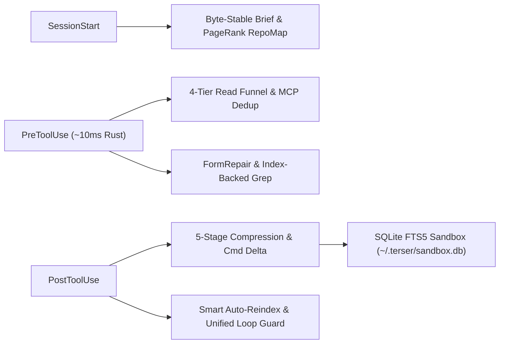

<div align="center">

<picture>
  
</picture>

<br />

[](plugin.json)
[](#measured-benchmarks)
[-F97316?style=flat-square)](#native-rust-hot-path-terser-fast)
[](#requirements)
[](#quick-start)
[](LICENSE)

**One fast, single-process, fail-open token-efficiency engine for Antigravity 2.0, Claude Code, and Codex.**

[Quick Start](#quick-start) · [Benchmarks](#measured-benchmarks) · [How It Works](#how-it-works) · [Rust Hot-Path](#native-rust-hot-path-terser-fast) · [CLI & Commands](#cli--slash-commands) · [Configuration](#configuration)

</div>

---

## Why Terser?

AI coding agents burn most of their context window on noise: bloated MCP tool schemas, repeated full-file reads, verbose build and test logs, repetitive JSON payloads, lockfile diffs, and retry loops.

**Terser** intercepts that waste across the entire tool lifecycle—**without sacrificing code quality, error fidelity, or KV prompt-cache hits**:

| Guarantee | What Terser Delivers |
| :--- | :--- |
| **94.4% Token Reduction** | Measured across 8 optimization layers on realistic developer workloads (`58,940` → `3,295` tokens). |
| **Zero Quality Compromise** | Errors, tracebacks, diffs, and exit codes are preserved **100% verbatim**. Full raw outputs are archived locally in SQLite FTS5 for instant drill-down. |
| **KV Prompt-Cache Safe** | Byte-stable session briefs and deterministic PageRank repo maps keep prompt prefix caches warm. |
| **~10 ms Native Hot-Path** | Default-on Rust accelerator (`terser-fast`) runs `PreToolUse` hooks **14.1× faster** (~147 ms → ~10 ms), with seamless pure-Python stdlib fallback. |
| **100% Local & Fail-Open** | Zero runtime dependencies, zero network calls, zero telemetry. Every hook exits `0` on error so your workflow is never blocked. |

### What It Looks Like in Practice

```text
Without Terser                                    With Terser
───────────────────────────────────────────────   ──────────────────────────────────────────────────────
• MCP AST server loads 90+ schemas (~25,800 tok)  • 6-tool Counter front door (~1,050 tok, 95.9% cut)
• Re-reading unchanged 300L file (~3,603 tok)     • T0 hash dedup hit (~38 tok, 98.9% cut)
• Re-reading after 2-line edit (~3,603 tok)       • T1 exact unified delta diff (~93 tok, 97.4% cut)
• Running cargo build / pytest (~450–505 tok)     • Stream filter + delta-diff (~34–94 tok, errors 100%)
• Oversized 50 KB log dumped into context         • Archived to SQLite FTS5 → terse query --last "ERR"
```

---

## Quick Start

### Requirements

- **Python 3.10+** — pure standard library; zero `pip install` or external MCP packages required (the `terser-index` AST MCP server is built in).
- **Rust (`cargo`)** *(optional)* — prebuilt `terser-fast` binaries are fetched automatically from [GitHub Releases](https://github.com/HyperExtendedReality/terser/releases), or compiled locally if `cargo` is present.

### Install

```bash
git clone https://github.com/HyperExtendedReality/terser.git
cd terser
```

#### Antigravity 2.0 / IDE / `agy`

```powershell
python scripts/install.py --antigravity
```

Installs into `~/.gemini/config/plugins/terser/` with OS-native hooks and the 6-tool Counter MCP config (safe to re-run in place on Windows even while Antigravity is running).

> [!TIP]
> If you previously installed standalone token-optimization or code-indexing plugins, disable them in Antigravity Customizations to avoid duplicate hooks and schemas.

#### Claude Code

```bash
claude plugin marketplace add "/path/to/terser"
claude plugin install terser@terser

# Update after pulling new commits:
claude plugin update terser@terser
```

Or test for a single session without installing:

```bash
claude --plugin-dir "/path/to/terser"
```

#### Codex

```bash
python scripts/install.py --codex
codex plugin marketplace add "/path/to/terser"
codex plugin add terser@terser

# Update after pulling new commits:
codex plugin marketplace upgrade
```

#### Install Everywhere / Dry-Run / Uninstall

```bash
python scripts/install.py --all            # Configure Antigravity, Codex & print Claude commands
python scripts/install.py --all --dry-run  # Preview changes without modifying files
python scripts/install.py --all --uninstall
```

---

## Measured Benchmarks

Reproduce these numbers offline anytime with `scripts/terse benchmark` (or `python scripts/benchmark.py`):

| Optimization Layer | Before | After | Saved | Reduction |
| :--- | ---: | ---: | ---: | :--- |
| **MCP Schema** (6-tool Counter vs Full) | 25,800 tok | 1,050 tok | **95.9%** | `██████████` |
| **Read Funnel T0** (Unchanged Re-read Dedup) | 3,603 tok | 38 tok | **98.9%** | `██████████` |
| **Read Funnel T1** (Small-Edit Unified Delta) | 3,603 tok | 93 tok | **97.4%** | `██████████` |
| **Read Funnel T2** (Outline-First Code) | 3,603 tok | 689 tok | **80.9%** | `████████░░` |
| **Read Funnel T2b** (Outline-First Markdown) | 5,753 tok | 329 tok | **94.3%** | `█████████░` |
| **Stream Output Filter** (Cargo Build) | 447 tok | 34 tok | **92.4%** | `█████████░` |
| **Lossless Columnar JSON Folding** | 1,751 tok | 244 tok | **86.1%** | `█████████░` |
| **Command Delta-Diff** (Repeat `pytest`) | 505 tok | 94 tok | **81.4%** | `████████░░` |
| **SQLite FTS5 Sandbox Query** | 5,678 tok | 462 tok | **91.9%** | `█████████░` |
| **SmartCrusher JSON** (120 API items) | 4,342 tok | 190 tok | **95.6%** | `██████████` |
| **Git Lockfile Diff Elision** | 3,855 tok | 72 tok | **98.1%** | `██████████` |
| **TOTAL (pooled across 8 layers)** | **58,940 tok** | **3,295 tok** | **94.4%** | `█████████▌` |

---

## How It Works



### The 8-Layer Optimization Stack

1. **6-Tool AST Front Door (`terser-index`)**
   Exposes only 6 Counter tools (~1,050 schema tokens vs. ~25,800 full — **96% cut**) across 81+ tree-sitter languages while keeping all 90+ AST and graph actions (`get_symbol_source`, `get_blast_radius`, `get_call_hierarchy`, `check_edit_safe`) one call away via `menu`, `order`, and `route`.
2. **4-Tier Read Funnel**
   - **T0** unchanged re-read dedup · **T1** exact unified delta-diff on small edits · **T2/T2b** outline-first for large code/Markdown (`>=10 KB`, `>=250L`) · **T3** instant passthrough for small/ranged reads + 120s read-only MCP dedup.
   - Built-in `soft_denies=1` retry escape and **auto-backoff** (`outline_backoff_limit=2`) prevent extra round-trips on whole-file tasks.
3. **FormRepair → 5-Stage Compression → Command Delta-Diff**
   Applies **FormRepair** first, then ANSI/OSC-8 stripping → stream noise filters (Cargo, Go, pip/uv, pnpm/npm, Vite/tsc) + 25 output handlers → duplicate-line collapse → lossless columnar JSON folding → cross-run Command Delta-Diff on repeated test/lint/git runs. Tee-on-failure guardrails keep 100% of errors, tracebacks, diffs, and exit codes.
4. **SmartCrusher JSON Pruner**
   Statistically summarizes repetitive JSON arrays and API responses while indexing the full raw payload for instant `terse query` retrieval.
5. **SQLite FTS5 Context Sandbox**
   Oversized command, MCP, `Glob`, and `Grep` outputs are chunk-indexed into `~/.terser/sandbox.db` (stdlib `sqlite3` FTS5, auto-pruned at 7 days / 50 MB). Query exact chunks (`terse query --last "<terms>"`) or line spans (`terse expand --last 1 80`) instead of dumping 100 KB logs.
6. **Byte-Stable PageRank RepoMap**
   Automatic `<150 ms` AST import-graph PageRank fallback (~300 tokens) *only* when a workspace is not yet indexed. Deterministic sorting + mtime fingerprinting keeps the KV prompt cache 100% warm.
7. **Pragmatic Minimalism & Consolidated Skills**
   Ships a `<220`-token `rules/AGENTS.md` policy, 3 focused skills (`terser`, `terser-index`, `terser-tune`), and a `SubagentStart` economy brief—explicitly forbidding cuts to validation, error handling, security, or accessibility.
8. **Unified Loop Guard & Smart Auto-Reindex**
   Per-session cooldown (45s), content-hashed edit signatures (no false positives on multi-region edits), and index-gated incremental AST re-indexing on file edits.

---

## Native Rust Hot-Path (`terser-fast`)

`scripts/install.py` enables the ~390 KB native Rust hot-path binary (`native/terser-fast/` → `bin/terser-fast`) **by default**—reusing an existing build, compiling with `cargo` if installed, or downloading the matching prebuilt binary from [GitHub Releases](https://github.com/HyperExtendedReality/terser/releases).

- **14.1× faster hooks:** Cuts `PreToolUse` latency from **~147 ms → ~10 ms**.
- **Native fast paths:** Read Funnel T0/T3, MCP refetch dedup, Loop Guard, `SubagentStart` brief, `terser-fast compress` (ANSI/OSC-8 strip, lockfile diff elision, Cargo/Go/pytest/npm/pnpm/pip/uv stream filters, duplicate-line collapse), and `terser-fast exec` (zero-overhead Antigravity `run_command` wrapper with tee-on-failure).
- **Transparent Python fallback:** Cold-path and rich operations (AST outlines, unified diffs, FormRepair, command delta-diff, SQLite FTS5 archival, audit/dashboard) delegate seamlessly to Python while sharing the exact same `~/.terser/` state files. Pass `--no-native` to run pure Python stdlib.

---

## CLI & Slash Commands

### Built-In Slash Commands & Skills

- **Claude Code slash commands:** `/terser:status`, `/terser:audit`, `/terser:dashboard`, `/terser:doctor`, `/terser:tune`
- **Agent skills (Antigravity, Claude Code & Codex):** `terser` (status/audit/dashboard), `terser-index` (AST symbol-first navigation), `terser-tune` (settings, micro-skills, tool pruning)

### `terse` CLI Quick Reference

Invoke via `scripts/terse` (macOS/Linux), `scripts/terse.cmd` (Windows), or `python runtime/cli.py`:

| Category | Command | Purpose |
| :--- | :--- | :--- |
| **Monitor** | `terse status` | Live status, per-layer % savings & outline override stats |
| | `terse benchmark` | Reproducible 8-layer local token-savings benchmark |
| | `terse audit` | Full session token & cost waste audit |
| | `terse audit-config` | Static context bloat & secret-leak audit |
| | `terse dashboard` | Refresh & open the local analytics dashboard |
| | `terse doctor` | Verify Python, Rust hot-path, engines, manifests & MCP |
| **Navigate** | `terse query <id\|--last> "<terms>"` | SQLite FTS5 search over an archived output |
| | `terse expand <id\|--last> [start end]` | Expand a line range (or full text) of an archive |
| | `terse repomap [--budget 400]` | Generate a byte-stable PageRank structural repo map |
| | `terse route "<task>"` | Zero-cost task complexity router (tier + score) |
| **Tune** | `terse config show` | Inspect active settings |
| | `terse config set <key>=<value>` | Toggle features (e.g. `shadow=true`, `outline_first=false`) |
| | `terse microskills [forget\|unforget]` | Manage learned repo EnvFacts micro-skills |
| | `terse toolprune [status\|apply\|restore]` | Review, apply, or restore unused tool pruning |
| | `terse coach` | Project-level token-efficiency coaching |

---

## Configuration

All local state and settings live under `~/.terser/` (override with `TERSER_HOME`). Persistent toggles can be set via `terse config set <key>=<value>` and reset anytime with `terse config reset`.

| Environment Variable | Effect |
| :--- | :--- |
| `TERSER_HOME` | Override state directory (default: `~/.terser`) |
| `TERSER_DISABLE=1` | Temporarily disable all hooks (instant passthrough) |
| `TERSER_SHADOW=1` | Shadow mode — log decisions without altering tool calls |
| `TERSER_PYTHON` | Explicit Python interpreter path for shell launchers |
| `TERSER_OUTLINE_FIRST=0` | Disable outline-first reads for large files |
| `TERSER_BASH_COMPRESS=0` | Disable shell output compression |
| `TERSER_LOOP_GUARD=0` | Disable loop/thrash intervention |

---

## Safety & Privacy

- **100% Local:** Zero outbound runtime network requests, zero telemetry, zero external API calls.
- **Fail-Open Architecture:** Every lifecycle hook is wrapped in defensive error handling and exits `0` so an unexpected edge case never blocks your agent.
- **Reversible by Design:** Oversized outputs remain searchable in `~/.terser/sandbox.db` via `terse query --last` or `terse expand --last`, and shadow mode (`terse config set shadow=true`) lets you audit decisions with zero mutation.

---

<details>
<summary><strong>Development, Testing & Releases</strong></summary>

```bash
# Run the full Python & native integration test suite
python -m unittest discover -s tests -v

# Run Rust unit tests
cargo test --manifest-path native/terser-fast/Cargo.toml

# Run the local token-savings benchmark
python scripts/benchmark.py

# Force-rebuild the Rust hot-path accelerator (~10ms hook latency)
python scripts/install.py --build-native --antigravity

# Bump semantic version across all manifests & rebuild standalone dist/ bundles
python scripts/install.py --bump patch --build-dist
```

</details>

---

## License

[GNU General Public License v3.0 (GPL-3.0)](LICENSE) © 2026 HyperExtendedReality
